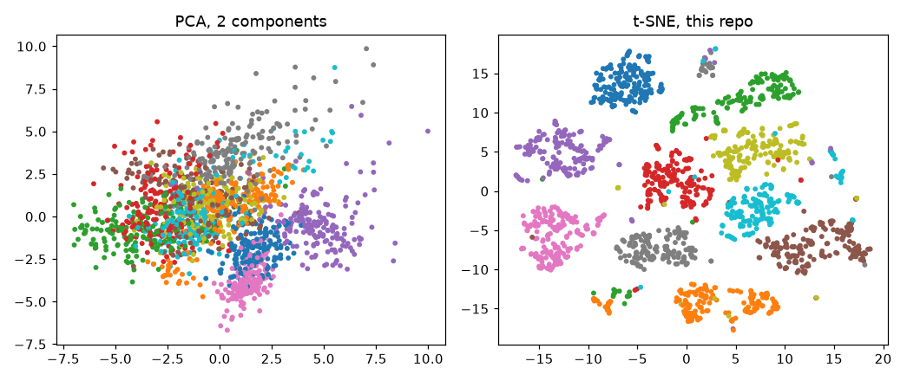

# tsne-numpy

t-SNE from scratch in NumPy: the Gaussian input affinities with a
perplexity binary search, the Student-t output distribution, the KL
divergence and its gradient, and the momentum optimizer with early
exaggeration. All backprop is written out by hand and checked against
finite differences.

On the sklearn digits set (1797 points, 8x8 images, ten classes):

| metric (k=10 neighbors) | t-SNE, this repo | PCA, 2 components |
|---|---|---|
| kNN overlap | 0.550 | 0.121 |
| trustworthiness | 0.982 | 0.816 |

KL went from 1.489 after the early-exaggeration phase to 1.189 at
iteration 500. The kNN overlap number is the share of each point's ten
nearest neighbors in the input that are still ten nearest neighbors in
the embedding. Trustworthiness is the sklearn definition, and the test
suite checks my implementation against sklearn's.



## What is implemented

- `affinity.py`: pairwise squared distances, per-point binary search
  for beta = 1/(2 sigma^2) that hits a target perplexity, and the
  symmetric joint distribution P with zero diagonal.
- `tsne.py`: q_ij = 1/(1 + d^2) normalized over off-diagonal pairs,
  the symmetric KL, the gradient
  dC/dy_i = 4 sum_j (P_ij - Q_ij) (1 + d^2)^-1 (y_i - y_j), and the
  optimizer: momentum 0.5 rising to 0.8, early exaggeration of 4 for
  the first 100 iterations, input PCA down to 50 dimensions first.
- `eval.py`: kNN overlap and trustworthiness.
- `data.py`: the sklearn digits set, standardized.

## Run it

```
pip install numpy matplotlib scikit-learn pytest
PYTHONPATH=src python3 -m tsne_numpy.train_driver
pytest tests/
```

Results and the figure land in `assets/`.

## Tests

Seven tests: P and Q are proper distributions, the binary search hits
the target perplexity, the KL gradient matches finite differences to
within a relative tolerance, the optimizer separates two well-separated
gaussian clusters, trustworthiness agrees with sklearn's to 1e-6, and
the kNN overlap metric returns 1.0 when the two spaces are the same.
